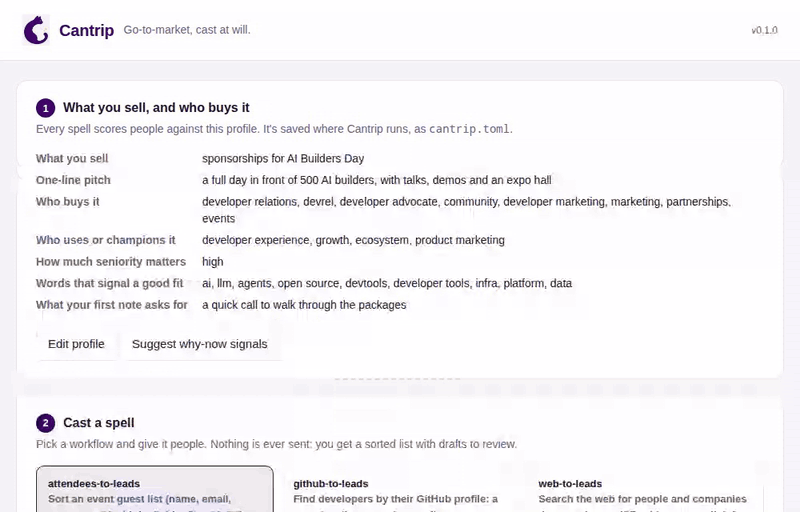

<p align="center">
  
</p>

<h1 align="center">Cantrip</h1>

<p align="center"><b>Go-to-market, cast at will.</b><br>
Tell it what you sell and who buys it. Open-source spells turn event attendees and GitHub profiles into sorted leads and drafted outreach.</p>

<p align="center"><a href="https://jilo3t.ipsion.page/workspace/cantrip-demo/"><b>Try the demo</b></a> (no sign-up) · <a href="#quick-start">Quick start</a> · <a href="#deploy-it">Deploy it</a></p>

<p align="center"></p>

---

Your best leads are people who already showed up: at your event, in a repo, on GitHub. Tell Cantrip what you sell and who buys it, and it scores each of those people against your ideal customer, sorts them best-first, and drafts a first note you can review. It works with the tools you already have, and it never sends anything on its own.

Each workflow is a **spell**: a small, product-neutral folder with its scoring rules in TOML and its steps written out so an AI agent can run them too. Your product and ICP live in one profile that every spell reads.

## Quick start

Cantrip needs Python 3.11 or newer and nothing else: no packages to install. Check with `python3 --version`. On a Mac, the built-in `python3` is 3.9, so install a newer one first (`brew install python@3.12`).

```bash
git clone https://github.com/cantrip-dev/cantrip.git && cd cantrip
./install.sh      # adds a `cantrip` command; nothing is downloaded
cantrip           # opens the app in your browser
```

The app walks you through it: describe what you sell and who buys it, drop in an attendee CSV or type a GitHub search, and press **Cast it**. See [the app](#the-app).

On Windows, skip `install.sh` and type `cantrip` inside the folder (`.\cantrip` in PowerShell), which runs `cantrip.cmd`; Windows support is new, so tell us if it breaks. Without the setup step, `python3 -m cantrip` works the same from the folder.

### From the command line

```bash
# 1. Tell Cantrip what you sell and who buys it (a few questions, saved to cantrip.toml)
cantrip init

# 2. Cast a spell on people who showed interest
cantrip cast attendees-to-leads --csv guests.csv --event "AI Builders Day" --out leads.csv
cantrip cast github-to-leads --search '"developer advocate" in:bio followers:>100' --limit 50 --out leads.csv
```

```
4 leads -> leads.csv, best first
hot 2, warm 1, cold 1
Companies with several good-fit people: Example Labs (2)
Top leads:
   93  Ada Example, Head of Developer Relations at Example Labs
   70  Grace Sample, Co-founder & CTO at Sample AI
Nothing was sent. Review the drafts, then send the ones you like yourself.
```

Each row of `leads.csv` has the person, a score from 0 to 100, a tier (hot, warm or cold), **the reasons for the score**, and a drafted note.

## The spellbook

| Spell | Signal in | Out |
| --- | --- | --- |
| [attendees-to-leads](spellbook/attendees-to-leads/) | an event guest list: name, email, company, job title, LinkedIn | attendees sorted by seniority, role and fit, with follow-up drafts |
| [github-to-leads](spellbook/github-to-leads/) | a GitHub user search, a list of logins, a repo's contributors or stargazers | developers scored on their public profile, with first-note drafts |
| [web-to-leads](spellbook/web-to-leads/) | the open web, searched by an AI model from your profile | named people and companies, each with its source page and a quote, and AI-written drafts |

Add `--research` to any spell to look up the best leads on the web and write their drafts around what turns up.

Add `--to notion` (or `hubspot`, `twenty`, `espocrm`) to any spell to put the hot and warm leads in your CRM too. See [Send leads to your CRM](#send-leads-to-your-crm).

Coming next: Discord and Reddit sources. Ideas and pull requests are welcome.

## The app

```bash
cantrip           # or: cantrip ui --port 8800
```

This opens Cantrip in your browser. Fill in your profile, drop in an attendee CSV or type a GitHub search, and press **Cast it**. You get your leads best-first, can filter by tier, read and copy each draft, and download the CSV. It runs on your own computer by default, or [deploy it](#deploy-it) to share it with your team. Either way it saves nothing but your profile.

<p align="center"></p>

## Deploy it

Cantrip runs the same on a server, so your team can use one copy from a browser. On anything but your own computer it asks for a password before it shows anything, and it won't start without one.

**With Docker** (any server, or a host that runs containers):

```bash
git clone https://github.com/cantrip-dev/cantrip.git && cd cantrip
cp .env.example .env      # set CANTRIP_PASSWORD (12+ characters) and any keys
docker compose up -d      # the app is on port 8765; your profile lives in a Docker volume
```

**Without Docker**, on any machine with Python 3.11+:

```bash
CANTRIP_PASSWORD='a long passphrase' cantrip ui --host 0.0.0.0 --port 8765 --no-browser
```

**On Render, in one click:** [](https://render.com/deploy?repo=https://github.com/cantrip-dev/cantrip) Render builds the image, generates a strong `CANTRIP_PASSWORD` (find it under the service's **Environment** tab) and keeps your profile on a 1 GB disk, which needs a paid instance ([render.yaml](render.yaml)). On a free instance, skip the disk and add your profile as a [secret file](https://render.com/docs/configure-environment-variables#secret-files) named `cantrip.toml`, with `CANTRIP_PROFILE=/etc/secrets/cantrip.toml`; edit it there, since the app can't save to it.

Other hosting platforms that build from a Dockerfile (Railway, Fly.io, Google Cloud Run...) work as they are: Cantrip listens on their `PORT`, answers their health check at `/healthz`, and reads its settings from their environment variables. Keep the profile on a persistent disk mounted at `/data`, or it resets when the app restarts.

| Setting | What it does |
| --- | --- |
| `CANTRIP_PASSWORD` | Required off your own computer, 12 characters or more. The browser asks for it (any user name). |
| `CANTRIP_HOST` / `--host` | Address to listen on: `127.0.0.1` (default, this computer only) or `0.0.0.0` (a server). The Docker image uses `0.0.0.0`. |
| `PORT` / `--port` | Port to listen on (default 8765). |
| `CANTRIP_PROFILE` / `--profile` | Where the profile is saved (the Docker image uses `/data/cantrip.toml`). |
| `CANTRIP_ALLOWED_HOSTS` | Optional: the addresses it answers to, comma-separated (e.g. `leads.example.com`). Anything else is refused. |
| `CANTRIP_DEMO` | `1` runs a public demo: no password and no keys, each visitor gets their own profile for the visit, and only the guest-list spell runs, on a sample list or the visitor's own CSV, which is never stored. |

Put it behind https (your host's, or a reverse proxy such as Caddy), since the password travels with every request. One copy is meant for one team: everyone who signs in shares the profile, the keys set on the server and the latest results.

## What it needs

- **Python 3.11 or newer.** Nothing else: no packages, no database, no account.
- **Files in, files out.** People come in as a CSV or from GitHub's public API; leads go out as a CSV, and to your CRM if you like. Your profile is one small text file (`cantrip.toml`).
- **Internet** only for the GitHub spell, which reads public GitHub profiles. A GitHub token is optional (5,000 lookups an hour instead of 60), except for stargazers, where GitHub requires one.
- **AI is optional.** The attendee and GitHub spells use plain rules and templates you can read. Web search, research mode and AI-written drafts need an AI model and a search service, with your own keys: OpenAI or any OpenAI-compatible API (including a free local model through Ollama) or Anthropic, and TinyFish, Exa, Tavily, Brave, Serper, SerpAPI or SearXNG, which is free and runs on your own computer ([one command with Docker](searxng/)). `cantrip search "a test query"` checks your search service works. Exa and Tavily support is in beta: not yet tried against the live services. See [web-to-leads](spellbook/web-to-leads/SPELL.md).

## Your product, your ICP

Cantrip doesn't assume what you sell. `cantrip init` asks:

- **What you sell,** and a one-line pitch, as you'd say it to a customer
- **Who buys it** and **who uses or champions it,** as job roles
- **Why now:** the moments that make someone worth writing to today (just raised a seed round, hired a first head of growth, launched on Show HN). Not sure? `cantrip why-now` suggests signals for your offer and checks each one shows up on the web; in the app, press **Suggest why-now signals**
- **Company stages** you sell to (seed, Series A...), so later-stage companies rank lower
- **How much seniority matters** (high, normal, low or ignore)
- **Target companies, fit keywords** and, for GitHub spells, **languages**
- **Who to deprioritize or skip,** like students, your own company or competitors
- **What your first note asks for,** and the name to sign with

It saves your answers to `cantrip.toml`, and every spell scores and writes against it. The same guest list ranks differently for a database startup (CTOs and engineers first) than for an event selling sponsorships (DevRel and marketing first). Edit the file any time, or keep one per product and pick one with `--profile`.

You can skip the questions and pass everything as flags, which is handy for agents and scripts:

```bash
cantrip init --name "Acme Vector" --pitch "a vector database that runs inside Postgres" \
  --buyer-roles "head of engineering, cto, platform" --champion-roles "ml engineer, backend engineer" \
  --keywords "rag, search, llm" --languages "Python, Go" --exclude "acme.dev" \
  --ask "a 15-minute call" --sender Sam
```

Four ready-made examples live in [`examples/profiles/`](examples/profiles/): a devtool startup, an event selling sponsorships, a B2B SaaS tool, and Cantrip itself (the one the demo uses). Try one with `--profile examples/profiles/devtool-startup.toml`.

To change how a spell scores or writes (the seniority ladder, the weights, the note templates), override it under `[weights]` or `[templates]` in your profile, or copy the spell's folder and edit its `spell.toml`.

## Send leads to your CRM

Cantrip always writes a CSV. Add `--to` and it also puts the leads in a CRM, or in the app press **Add to CRM** under your results:

```bash
cantrip cast attendees-to-leads --csv guests.csv --to notion                 # hot and warm leads
cantrip cast web-to-leads --web --to twenty --crm-tier hot                   # hot leads only
```

It adds people who aren't there yet and leaves everyone already there alone (matched by email, LinkedIn, or name and company), so you can run a spell again without duplicates and it never overwrites your notes or status. Each lead carries its score, the reasons, where it was found and the draft, marked not sent. Nothing is emailed to anyone.

| `--to` | Cost | Settings |
| --- | --- | --- |
| `notion` | free | `CANTRIP_NOTION_TOKEN`: create an integration at notion.so/profile/integrations and copy its secret. Open your database, press **...** > **Connections** and add the integration. `CANTRIP_NOTION_DATABASE`: the database's link. Cantrip adds the columns it needs (Email, Company, Score, Tier, Status, Why...) and leaves yours alone. |
| `hubspot` | free plan works | `CANTRIP_HUBSPOT_TOKEN`: a private app token with the contacts read and write scopes. Leads become contacts with a note. |
| `twenty` | open source, self-host free (or Twenty's cloud) | `CANTRIP_TWENTY_KEY`: Settings > Developers > API key. `CANTRIP_TWENTY_URL`: your Twenty's address if self-hosted. Leads become people linked to their company, with a note. |
| `espocrm` | open source, self-host free | `CANTRIP_ESPO_KEY`: an API user's key (Administration > API Users). `CANTRIP_ESPO_URL`: your EspoCRM's address. Leads become Leads with status New. |

> **Beta.** The CRM outputs are tested against simulated API answers, not yet against live Notion, HubSpot, Twenty or EspoCRM accounts. Try one on a test database first, and [open an issue](https://github.com/cantrip-dev/cantrip/issues) if something breaks.

Want a self-hosted CRM in one command? Twenty and EspoCRM both ship a Docker setup: see their own install guides.

## Quality over quantity

Cantrip would rather hand you ten leads worth writing to than a hundred names:

- **A reason to write now.** Web leads need a quote from their page showing one of your why-now signals to be hot. Old news (more than six months) still counts as a fit, not as a reason.
- **One company per page.** Roundups, rankings, investor lists and directories that name many companies are skipped.
- **Your words, not the AI's.** A draft is one factual opening line about the lead, then your pitch and your ask exactly as your profile states them. The AI never recasts your offer to fit the lead, guesses at their problems or flatters them; if it can't state a real fact, there's no hook at all.

## Built for agents

Every spell has a `SPELL.md`, the same workflow written as steps an agent can follow: interview the person for their profile if there isn't one, run the CLI, check the scoring, shortlist the best leads, read their public work, rewrite each note around one true, specific detail, and hand the drafts back to a human. Point your agent at the file and say "cast this spell".

**[Cantrip Familiar](familiar/)** runs that workflow on its own, every morning, as a [Guild](https://www.guild.ai/) agent: it casts a spell on your deployed Cantrip, reads the best leads' public GitHub, and leaves you a digest of drafts. It has no tool that can send, and Guild's credential rules keep it read-only.

## Principles

- **Drafts, not sends.** A human approves every message.
- **Public data only.** No LinkedIn scraping and no guessed private emails.
- **Explainable.** Every score comes with its reasons.
- **Connects, doesn't rebuild.** Your CRM, email and analytics stay where they are.
- **No dependencies.** Plain Python 3.11+, so it's easy to read, audit and fork.

## Contributing

See [CONTRIBUTING.md](CONTRIBUTING.md). We use DCO sign-off (`git commit -s`).

## Security

Cantrip runs on your computer with your own keys. It has no dependencies, so there's no third-party package to compromise, and [Snyk](https://snyk.io/) scans its code and Docker image on every change. To report a security problem, see [SECURITY.md](SECURITY.md).

## License

[Apache 2.0](LICENSE)
