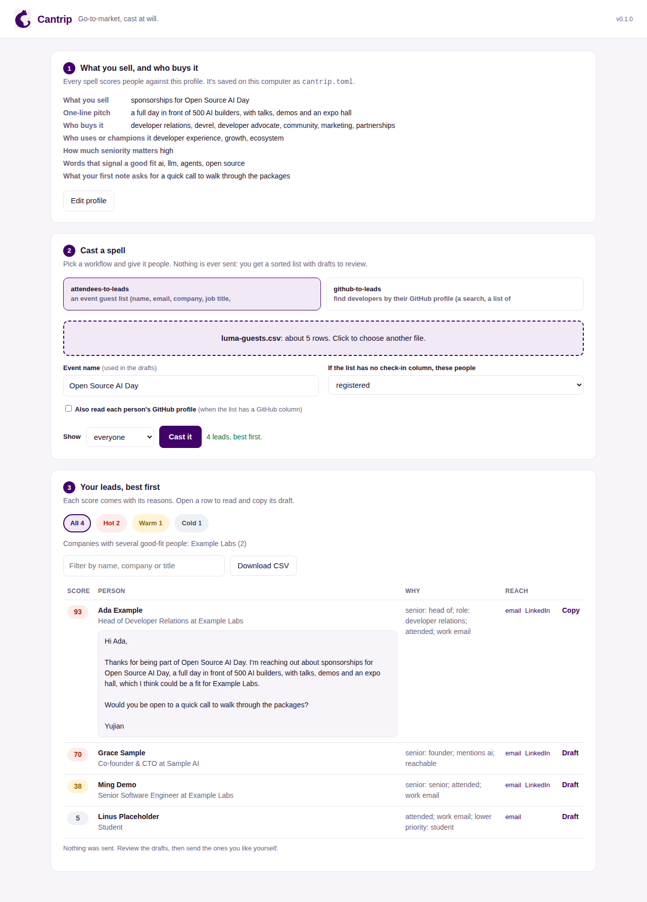

<p align="center">
  
</p>

<h1 align="center">Cantrip</h1>

<p align="center"><b>Go-to-market, cast at will.</b><br>
Tell it what you sell and who buys it. Open-source spells turn event attendees and GitHub profiles into sorted leads and drafted outreach.</p>

---

Your best leads are people who already showed up: at your event, in a repo, on GitHub. Tell Cantrip what you sell and who buys it, and it scores each of those people against your ideal customer, sorts them best-first, and drafts a first note you can review. It works with the tools you already have, and it never sends anything on its own.

Each workflow is a **spell**: a small, product-neutral folder with its scoring rules in TOML and its steps written out so an AI agent can run them too. Your product and ICP live in one profile that every spell reads.

## Quick start

Cantrip needs Python 3.11 or newer. Check with `python3 --version`. On a Mac, the built-in `python3` is 3.9, so install a newer one first (`brew install python@3.12`) and make the environment with it:

```bash
git clone https://github.com/cantrip-dev/cantrip.git && cd cantrip
python3.12 -m venv .venv && source .venv/bin/activate
pip install -e .

# 1. Tell Cantrip what you sell and who buys it (a few questions, saved to cantrip.toml)
cantrip init

# 2. Cast a spell on people who showed interest
cantrip cast attendees-to-leads --csv guests.csv --event "AI Builders Day" --out leads.csv
cantrip cast github-to-leads --search '"developer advocate" in:bio followers:>100' --limit 50 --out leads.csv
```

```
4 leads -> leads.csv, best first
hot 2, warm 1, cold 1
Companies with several good-fit people: Example Labs (2)
Top leads:
   93  Ada Example, Head of Developer Relations at Example Labs
   70  Grace Sample, Co-founder & CTO at Sample AI
Nothing was sent. Review the drafts, then send the ones you like yourself.
```

Each row of `leads.csv` has the person, a score from 0 to 100, a tier (hot, warm or cold), **the reasons for the score**, and a drafted note.

## The spellbook

| Spell | Signal in | Out |
| --- | --- | --- |
| [attendees-to-leads](spellbook/attendees-to-leads/) | an event guest list: name, email, company, job title, LinkedIn | attendees sorted by seniority, role and fit, with follow-up drafts |
| [github-to-leads](spellbook/github-to-leads/) | a GitHub user search, a list of logins, a repo's contributors or stargazers | developers scored on their public profile, with first-note drafts |
| [web-to-leads](spellbook/web-to-leads/) | the open web, searched by an AI model from your profile | named people and companies, each with its source page and a quote, and AI-written drafts |

Add `--research` to any spell to look up the best leads on the web and write their drafts around what turns up.

Coming next: Discord and Reddit sources, and CRM outputs. Ideas and pull requests are welcome.

## Prefer clicking? Use the app

```bash
cantrip ui
```

This opens Cantrip in your browser. Fill in your profile, drop in an attendee CSV or type a GitHub search, and press **Cast it**. You get your leads best-first, can filter by tier, read and copy each draft, and download the CSV. The app runs only on your own computer (127.0.0.1) and saves nothing but your profile.

<p align="center"></p>

## What it needs

- **Python 3.11 or newer.** Nothing else: no packages to install, no database, no account.
- **Files in, files out.** People come in as a CSV or from GitHub's public API; leads go out as a CSV. Your profile is one small text file (`cantrip.toml`).
- **Internet** only for the GitHub spell, which reads public GitHub profiles. A GitHub token is optional (5,000 lookups an hour instead of 60), except for stargazers, where GitHub requires one.
- **AI is optional.** The attendee and GitHub spells use plain rules and templates you can read. Web search, research mode and AI-written drafts need an AI model and a search service, with your own keys: OpenAI or any OpenAI-compatible API (including a free local model through Ollama) or Anthropic, and Tavily, Brave, SerpAPI or a self-hosted SearXNG. See [web-to-leads](spellbook/web-to-leads/SPELL.md).

## Your product, your ICP

Cantrip doesn't assume what you sell. `cantrip init` asks:

- **What you sell,** and a one-line pitch, as you'd say it to a customer
- **Who buys it** and **who uses or champions it,** as job roles
- **How much seniority matters** (high, normal, low or ignore)
- **Target companies, fit keywords** and, for GitHub spells, **languages**
- **Who to deprioritize or skip,** like students, your own company or competitors
- **What your first note asks for,** and the name to sign with

It saves your answers to `cantrip.toml`, and every spell scores and writes against it. The same guest list ranks differently for a database startup (CTOs and engineers first) than for an event selling sponsorships (DevRel and marketing first). Edit the file any time, or keep one per product and pick one with `--profile`.

You can skip the questions and pass everything as flags, which is handy for agents and scripts:

```bash
cantrip init --name "Acme Vector" --pitch "a vector database that runs inside Postgres" \
  --buyer-roles "head of engineering, cto, platform" --champion-roles "ml engineer, backend engineer" \
  --keywords "rag, search, llm" --languages "Python, Go" --exclude "acme.dev" \
  --ask "a 15-minute call" --sender Sam
```

Three ready-made examples live in [`examples/profiles/`](examples/profiles/): a devtool startup, an event selling sponsorships, and a B2B SaaS tool. Try one with `--profile examples/profiles/devtool-startup.toml`.

To change how a spell scores or writes (the seniority ladder, the weights, the note templates), override it under `[weights]` or `[templates]` in your profile, or copy the spell's folder and edit its `spell.toml`.

## Built for agents

Every spell has a `SPELL.md`, the same workflow written as steps an agent can follow: interview the person for their profile if there isn't one, run the CLI, check the scoring, shortlist the best leads, read their public work, rewrite each note around one true, specific detail, and hand the drafts back to a human. Point your agent at the file and say "cast this spell".

## Principles

- **Drafts, not sends.** A human approves every message.
- **Public data only.** No LinkedIn scraping and no guessed private emails.
- **Explainable.** Every score comes with its reasons.
- **Connects, doesn't rebuild.** Your CRM, email and analytics stay where they are.
- **No dependencies.** Plain Python 3.11+, so it's easy to read, audit and fork.

## Contributing

See [CONTRIBUTING.md](CONTRIBUTING.md). We use DCO sign-off (`git commit -s`).

## License

[Apache 2.0](LICENSE)
